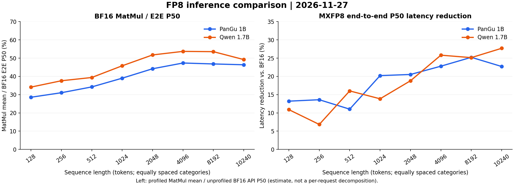

# FP8 inference: PanGu 1B 与 Qwen 1.7B

2026-11-27 整理。比较 BF16 基线中的矩阵乘耗时占比，以及优化 MXFP8 相对 BF16 的端到端 P50 时延降低百分比。

[查看 A2 上五个 OneRec 下游任务的 MXFP8 精度对比](docs/onerec-a2-mxfp8-accuracy.md)

## 对照汇总

| Seq（token） | PanGu 1B：BF16 矩阵乘占比 | Qwen 1.7B：BF16 矩阵乘占比 | PanGu 1B：P50 时延降低 | Qwen 1.7B：P50 时延降低 |
|---:|---:|---:|---:|---:|
| 128 | 44.16% | 51.33% | 13.21% | 10.89% |
| 256 | 45.49% | 52.56% | 13.60% | 6.83% |
| 512 | 47.97% | 55.16% | 11.02% | 16.02% |
| 1024 | 52.25% | 59.31% | 20.21% | 13.86% |
| 2048 | 55.81% | 62.63% | 20.52% | 18.80% |
| 4096 | 56.72% | 62.10% | 22.79% | 25.81% |
| 8192 | 52.35% | 57.58% | 25.22% | 25.14% |
| 10240 | 49.82% | 55.11% | 22.71% | 27.70% |

## PanGu 1B 明细

[下载 CSV](data/pangu_1b.csv)

| Seq（token） | BF16 矩阵乘耗时占比 | BF16 P50（ms） | MXFP8 P50（ms） | 端到端 P50 降低 |
|---:|---:|---:|---:|---:|
| 128 | 44.16% | 19.460 | 16.889 | 13.21% |
| 256 | 45.49% | 19.657 | 16.982 | 13.60% |
| 512 | 47.97% | 21.365 | 19.010 | 11.02% |
| 1024 | 52.25% | 25.121 | 20.043 | 20.21% |
| 2048 | 55.81% | 33.991 | 27.016 | 20.52% |
| 4096 | 56.72% | 52.228 | 40.323 | 22.79% |
| 8192 | 52.35% | 96.415 | 72.099 | 25.22% |
| 10240 | 49.82% | 119.043 | 92.014 | 22.71% |

## Qwen 1.7B 明细

[下载 CSV](data/qwen_1_7b.csv)

| Seq（token） | BF16 矩阵乘耗时占比 | BF16 P50（ms） | MXFP8 P50（ms） | 端到端 P50 降低 |
|---:|---:|---:|---:|---:|
| 128 | 51.33% | 22.773 | 20.293 | 10.89% |
| 256 | 52.56% | 22.592 | 21.049 | 6.83% |
| 512 | 55.16% | 25.691 | 21.575 | 16.02% |
| 1024 | 59.31% | 30.502 | 26.275 | 13.86% |
| 2048 | 62.63% | 42.639 | 34.625 | 18.80% |
| 4096 | 62.10% | 70.496 | 52.299 | 25.81% |
| 8192 | 57.58% | 125.582 | 94.006 | 25.14% |
| 10240 | 55.11% | 169.140 | 122.284 | 27.70% |

## 统计口径与来源

- 时延降低百分比 = `(BF16 P50 − MXFP8 P50) / BF16 P50 × 100%`；不展示加速倍数。
- BF16 矩阵乘占比 = MatMul/GEMM 算子累计耗时 / 全部 NPU 算子累计耗时，覆盖 Prefill 与两步 Decode，包含 LM Head；不包含主机开销和空闲间隙。融合 Attention 内部的 QK/AV 乘法归入 Attention，不重复计入 MatMul。
- PanGu 实测：Ascend950DT，物理卡 4；batch size 1、beam width 128、生成 3 步、NPU table 约束解码。每个长度使用精确长度的 Prefill 图桶；Prefill 与 Decode 均实际重放，零回退。
- PanGu 每种精度使用同一批 60 条不同随机输入，先预热 10 条，再连续测量 50 条计算 API 端到端 P50。之后开启 profiler 采集 5 条，算子耗时使用这 5 条的均值。每场景合计 65 次 Prefill、130 次 Decode 图重放。
- PanGu MXFP8 使用此前在该环境验证表现最好的计算融合＋原生 KV 路径：RMSNorm＋量化、SwiGLU＋量化、QKV＋RoPE、QKV 合并与 bias 预转换。历史 KV gather/layout 路径关闭。Embedding、LM Head、Attention、KV cache 保持 BF16。这是已验证配置，不代表针对每个长度重新穷举优化。
- Qwen 数值逐项保留用户提供的表格；其原始日志、profile、物理卡和实际融合开关未在本次整理中独立核验。因此此处为并列结果汇总，不能视为两模型同卡同批输入的严格配对实验。
- PanGu CSV 保留未四舍五入的测量值；Qwen 表仅有三位小数时延与两位百分比，重算时可能存在末位舍入差异。

## 如何理解结果

两组数据中，BF16 独立矩阵乘占比都在中等长度较高，长序列时回落。PanGu 原始 profile 显示，从 8192 到 10240，矩阵乘耗时从 45.14 增至 55.19 ms，而 Prefill Attention 从 18.59 增至 28.32 ms；Attention 增长更快，拉低了矩阵乘占比。占比下降不代表矩阵乘绝对耗时下降。

PanGu 之前 1024-token 测试曾报告 P50 降低 28.0%，复测为 24.2%；本轮为 20.21%。历史测试使用不同物理卡及输入，未混入本轮表格。时延降低取决于配对 BF16 基线，不能把历史百分比直接套用到本轮。

## 数据与复核

- [并列汇总 CSV](data/comparison.csv)
- [PanGu 原始图重放核验摘要](data/pangu_graph_verification.json)
- [来源记录](data/provenance.json)
- `python verify.py`：校验序列对齐、数值范围，以及 P50 与降低百分比的一致性。

本仓库包含报告、数值与核验摘要。PanGu 完整日志和 profiler 证据保留在原始实验归档中；归档 SHA-256 见来源记录。
